<div align="center">

<picture><source media="(prefers-color-scheme: dark)" srcset="svg/relevo-lockup-horizontal-white.svg"></picture>

# La issue entra, la feature sale

**En medio, agentes de IA hacen el trabajo, de forma automática y casi sin intervención humana.**

</div>

Este es el logo final, el último estado de la animación. Una issue entró por la izquierda, agentes de IA hicieron el trabajo dentro del círculo y la feature salió por la derecha. Esta hoja explica cómo usarlo sin que deje de ser el mismo.

[Marca y licencia](LICENSE.md) · [Marca registrada](../../TRADEMARKS.es.md) · [Regenerar todo](source/README.md)

## Qué significa

Tres piezas, una historia.

<div align="center">

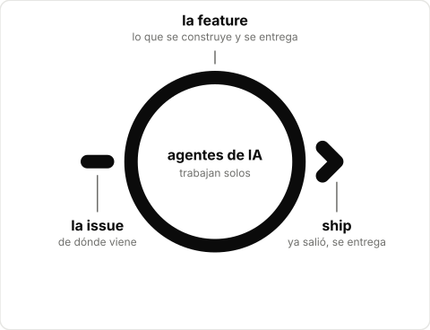

</div>

- **El círculo** es la feature. Lo vacío es el espacio donde trabajan los agentes de IA, de forma automática.
- **La rayita** es la issue: entra por la izquierda, siempre antes.
- **La punta** es `ship`: la feature ya salió, se entrega. Siempre a la derecha, siempre fuera del círculo.
- El negro aparece solo cuando una persona toma el testigo, para pensar y para revisar. Por eso el logo final está vacío: el trabajo lo hicieron los agentes.

## Construcción

Todo sale de una sola medida.

<div align="center">

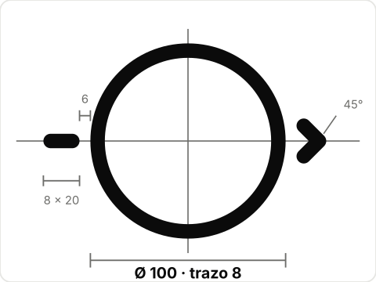

</div>

- Círculo de **Ø 100** y trazo de **8**, centrado en el contorno.
- La rayita y cada brazo de la punta miden lo mismo: **8 × 20**, con extremos redondeados.
- La separación entre el círculo y la rayita, y entre el círculo y la punta, es la misma: **6**.
- Los brazos de la punta forman **45°** con el eje y quedan a la misma altura que el centro.
- Esta repetición es lo que mantiene la marca ordenada. Cambiar una medida es cambiar el logo.

## Versiones

Son el mismo logo. Solo cambian el grosor del trazo y el fondo, para que se vea igual de bien a cada tamaño. No hay que mezclar versiones en una misma pantalla al mismo tamaño.

| | |
|:---:|---|
| <picture><source media="(prefers-color-scheme: dark)" srcset="svg/relevo-mark-white.svg">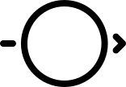</picture> | **Logo principal**<br>Desde 80 px de ancho. README, web, presentaciones, portadas. Trazo 8. |
| <picture><source media="(prefers-color-scheme: dark)" srcset="svg/relevo-mark-small-white.svg">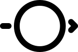</picture> | **Corte óptico**<br>De 40 a 79 px de ancho. Trazo 12 y detalles un poco más gruesos para que no se pierdan. Mismas proporciones. |
| <picture><source media="(prefers-color-scheme: dark)" srcset="svg/relevo-icon-white.svg">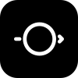</picture> | **Avatar, favicon, icono de app**<br>Desde 16 px. El mismo logo en blanco sobre un cuadrado negro (o al revés). El cuadrado es solo el contenedor, nunca parte del logo. |
| <picture><source media="(prefers-color-scheme: dark)" srcset="svg/relevo-lockup-horizontal-white.svg"></picture> | **Encabezados y barras**<br>El nombre va en Nunito SemiBold, en minúsculas, a la derecha. El centro del círculo queda a la altura del centro de las letras. |
| <picture><source media="(prefers-color-scheme: dark)" srcset="svg/relevo-lockup-vertical-white.svg">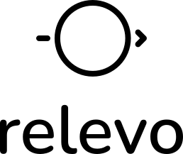</picture> | **Portadas y carteles**<br>El nombre debajo, centrado. Úsalo cuando haya más alto que ancho. |

## Animación

Cuatro segundos y medio, y se queda en ship.

<div align="center">

<picture><source media="(prefers-color-scheme: dark)" srcset="animation/relevo-logo-animated-white.svg"></picture>

</div>

Es la versión corta del logo animado, sin texto: el círculo nace, los agentes de IA trabajan, la issue entra y la feature sale. Se queda unos segundos en el logo final, se desvanece y vuelve a empezar (un ciclo dura unos 13 s). Es un bucle a propósito: un SVG no sabe cuándo está a la vista, así que quien llega con el scroll lo ve moverse en pocos segundos. Para el README y la web.

En un README de GitHub, con versión para tema oscuro:

```html
<picture>
  <source media="(prefers-color-scheme: dark)" srcset="docs/brand/animation/relevo-logo-animated-white.svg">
  
</picture>
```

Donde no se admite un SVG animado (algunos chats y correos) está el mismo recorrido en GIF (`animation/relevo-logo-animated.gif`), con fondo blanco, que también se repite. Quien abre el SVG en un visor sin animaciones ve directamente el logo final.

## Tamaños mínimos

Por debajo de 40 px, el icono.

<table><tr align="center" valign="bottom">
<td><br><sub>A · desde 80 px de ancho</sub></td>
<td><br><sub>G · de 40 a 79 px</sub></td>
<td><br><sub>Icono · desde 16 px</sub></td>
<td><br><sub>Icono a 16 px (favicon)</sub></td>
</tr></table>

Si el logo tendría que mostrarse a menos de 40 px de ancho, no lo reduzcas: usa el icono. A 16 px el icono se ve como un bloque con un círculo claro, que es suficiente para reconocerlo.

## Espacio libre

Medio círculo de aire alrededor.

<div align="center">

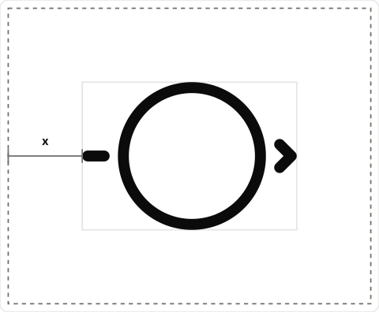

</div>

- Deja como mínimo **x** de espacio libre en todos los lados, donde **x = la mitad del diámetro del círculo** (54 unidades en el maestro).
- Nada de texto, bordes ni imágenes dentro de ese margen.
- Con el nombre, el margen se mide desde el borde del conjunto completo.

## Color y tipografía

Un solo color, una sola letra.

<div align="center">

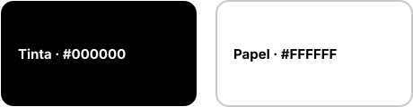

</div>

El logo es siempre de un solo color: tinta sobre papel, o papel sobre tinta. Sobre fotos o fondos de color, usa el que dé más contraste.

El nombre del logo es **Nunito SemiBold**, en minúsculas (licencia SIL OFL 1.1): con ese peso las letras y el símbolo se sienten dibujados con el mismo trazo. En las animaciones y la documentación, el texto de interfaz va en negrita: los comandos como `/relevo:` en gris y la palabra del comando en negrita, y lo que no es comando (**feature**, **relevo**) solo en negrita, sin prefijo.

## Qué no hacer

Ocho maneras de dejar de ser Relevo.

<table>
<tr align="center" valign="top"><td>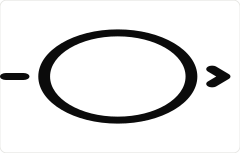<br><sub>✕ Estirarlo o aplastarlo</sub></td><td>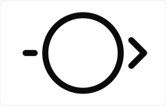<br><sub>✕ Agrandar la punta o cambiar sus ángulos</sub></td><td>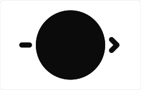<br><sub>✕ Rellenar el círculo: lo vacío son los agentes</sub></td><td>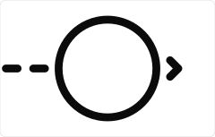<br><sub>✕ Añadirle elementos nuevos</sub></td></tr>
<tr align="center" valign="top"><td>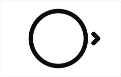<br><sub>✕ Quitarle la rayita</sub></td><td>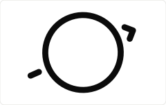<br><sub>✕ Girarlo</sub></td><td>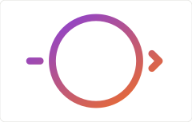<br><sub>✕ Degradados o colores sueltos</sub></td><td>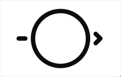<br><sub>✕ Sombras o contornos extra</sub></td></tr>
</table>

## Archivos

Qué hay en la carpeta `docs/brand/`. Todos los SVG tienen los trazos convertidos en formas y el texto en curvas, así que se ven igual aunque no esté instalada Nunito.

| Archivo | Para qué |
|---|---|
| `svg/relevo-mark-{black,white}.svg` | Logo maestro (A). Desde 80 px de ancho. |
| `svg/relevo-mark-small-{black,white}.svg` | Corte para tamaños pequeños (G). De 40 a 79 px. |
| `svg/relevo-lockup-horizontal-{black,white}.svg` | Logo con el nombre a la derecha. Encabezados y barras. |
| `svg/relevo-lockup-vertical-{black,white}.svg` | Logo con el nombre debajo. Portadas y carteles. |
| `svg/relevo-icon-{black,white}.svg` | Icono con esquinas redondeadas. Iconos de app y tarjetas. |
| `svg/relevo-avatar-{black,white}.svg` | Cuadrado completo, sin esquinas. Avatares: la plataforma lo recorta. |
| `svg/favicon.svg` | Favicon que se adapta al tema claro y oscuro. |
| `favicon.ico` | 16, 32 y 48 px, para navegadores antiguos. |
| `png/relevo-avatar-1024.png · 512.png` | Avatar de GitHub y redes. |
| `png/apple-touch-icon-180.png` | Icono de pantalla de inicio en iOS. |
| `png/relevo-icon-{black,white}-512.png` | Icono con transparencia en las esquinas. |
| `png/favicon-{16,32,48}.png` | Favicon en PNG. |
| `png/relevo-lockup-…, relevo-mark-…` | Versiones PNG con transparencia del logo y los lockups. |
| `png/relevo-social-preview-1280x640.png` | Vista previa social del repositorio en GitHub. |
| `states/relevo-state-<estado>-{black,white}.svg` | Una ilustración por comando del flujo: init, feature (que no es un comando, sino el motivo del flujo), think, issue, go, review, fix y ship. Son las del README. |
| `animation/relevo-logo-animated-{black,white}.svg` | Logo animado de 4,6 s, sin texto, que se queda en ship, se desvanece y vuelve a empezar. SMIL: se ve en GitHub y navegadores. |
| `animation/relevo-logo-animated.gif` | La misma animación en GIF, con fondo blanco, para donde no se admite SVG animado. |
| `source/` | Los scripts y la fuente para regenerar todo. Instrucciones en source/README.md. |
